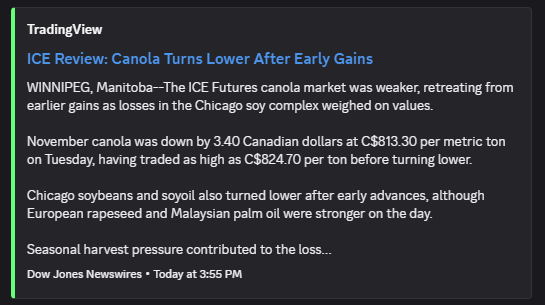
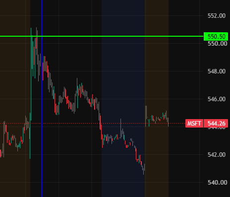

> [!WARNING]
> These scripts are experimental and may EXPLODE without warning (probably won't)

# TradingView API
Collection of scripts I personally use for interacting with the TradingView API unofficially.

### [News Flow](./scripts/news.js) `scripts\news`
Replicates the news flow stream. Logs story ID to SQLite DB to prevent duplicate/outdated notifications.

1. Fetches news screens from `https://news-mediator.tradingview.com/news-flow/v2/screens?streaming=true`

2. Fetches streaming channel from `https://news-mediator.tradingview.com/news-flow/v2/news`

3. Connects to streaming channel via EventSource at `https://notifications.tradingview.com/news/channel`

4. Fetches news article name, description and other attributes from `https://news-mediator.tradingview.com/public/news/v1/story`

5. Sends to Discord thru REST API, no logged-in client required.

Requires the following **.env variables**:
```
DISCORD_TOKEN - Bot token
DISCORD_MAIN_CHANNEL_ID - For important news
DISCORD_NEWS_CHANNEL_ID - For all news
TRADINGVIEW_COOKIE - Account cookie, locate using DevTools
```

Sample code: 
```
const { NewsFlow } = require('./news');
NewsFlow('All'); // wow that was easy!
```

Sample embed:
  

### [Drawings](./scripts/draw.js) `scripts\draw`
Places horizontal and vertical lines on a chart layout. Every line is tagged, so listing and deleting only ever touches lines made by this script and never the ones placed by hand.

1. Resolves the exchange for a bare ticker from `https://symbol-search.tradingview.com/symbol_search/v3/` (skipped if you pass `NASDAQ:MSFT`)

2. Writes lines to `https://charts-storage.tradingview.com/charts-storage/layout/{layout}/sources`

3. Reads them back from `https://charts-storage.tradingview.com/charts-storage/get/layout/{layout}/sources`

Requires the following **.env variables**:
```
TRADINGVIEW_COOKIE - Account cookie, locate using DevTools
TRADINGVIEW_JWT - Chart storage token, locate using DevTools (jwt= on any charts-storage request)
TRADINGVIEW_LAYOUT_ID - Layout to draw on, the ID in tradingview.com/chart/{ID}/
```

Sample code:
```
const { drawLine, listLines, deleteLines } = require('./draw');

const id = await drawLine('vertical', 'blue', 'MSFT', '2026-10-13T14:30:00Z');
await drawLine('horizontal', '#FF8000', 'MSFT', 550.50); // hex/rgba also works

await listLines('MSFT'); // [{ id, type, color, value }]
await deleteLines('MSFT', id); // one line
await deleteLines('MSFT'); // every line this script drew on MSFT
```

Sample chart:
 